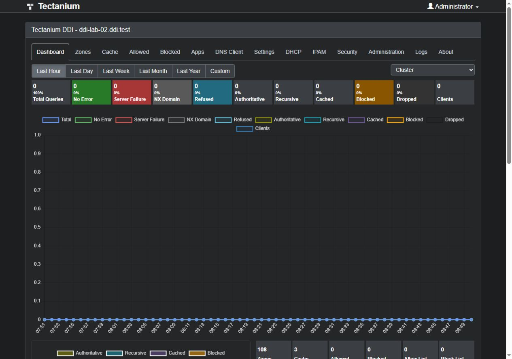

# Tectanium DDI Server

Open-source DNS, DHCP and IP address management from Tekmyster, with shared security evidence and optional local model assistance.

[Download the alpha](https://github.com/tekmyster/Tectanium-DDI-Server/releases/tag/v0.1.0-alpha.1) · [Feature status](docs/FEATURE-MATRIX.md) · [Report an issue](https://github.com/tekmyster/Tectanium-DDI-Server/issues) · [Tekmyster](https://tekmyster.com)

## Downloads

The published release is **0.1.0-alpha.1**. It includes a self-contained [Linux x64 package](https://github.com/tekmyster/Tectanium-DDI-Server/releases/download/v0.1.0-alpha.1/Tectanium-v0.1.0-alpha.1-linux-x64.tar.gz) and [SHA256SUMS](https://github.com/tekmyster/Tectanium-DDI-Server/releases/download/v0.1.0-alpha.1/SHA256SUMS).

Windows setup, additional portable packages and the next alpha are being prepared. They are not available in this release yet. Evaluate the alpha in an isolated deployment before replacing an existing DNS/DHCP service.

## Console

Tectanium uses a charcoal console with dedicated DNS, DHCP, IPAM and Security sections. This screenshot shows the isolated lab; it is not production telemetry.

## Capabilities

- Authoritative and recursive DNS, DNSSEC and encrypted DNS transports.
- Distributed IPv4 DHCP allocation and synchronization across multiple owners, with durable offers/leases and fenced recovery tested in the Hyper-V lab.
- IPv4/IPv6 IPAM inventory, network views, assignments, utilization and DNS/DHCP reconciliation.
- Reviewed publication of managed prefixes and addresses to NetBox.
- Local threat indicators, asynchronous MISP enrichment, shared DNS/DHCP evidence and analyst investigations.
- Explainable tunneling and DGA-pattern suspicion, periodic DNS observations and visible sampling limits.
- Optional Chat Completions-compatible event explanations. Separately operated model servers can use local GPUs; explanations are advisory and cannot change protection.
- Native configuration backups, migration previews and policy rollback.

Predictive intelligence, trained classifiers, learned baselines, DHCPv6 and several HA/IPAM workflows remain in development. See [the feature matrix](docs/FEATURE-MATRIX.md) and [security roadmap](docs/SECURITY-ROADMAP.md) for implementation and validation limits.

## Documentation

- [HTTP API](APIDOCS.md)
- [IPAM](docs/IPAM.md)
- [DHCP synchronization](docs/DHCP-SYNCHRONIZATION.md)
- [Backup and migration](docs/BACKUP-MIGRATION.md)
- [Optional model assistance](docs/SECURITY-LLM.md)
- [Product UX contract](docs/PRODUCT-UX.md)
- [Original logo and variants](docs/branding/README.md)

## License

Tectanium is distributed under [GNU GPL v3](LICENSE). Original copyright and required attribution are preserved in source headers and [third-party notices](THIRD-PARTY-NOTICES.md).
