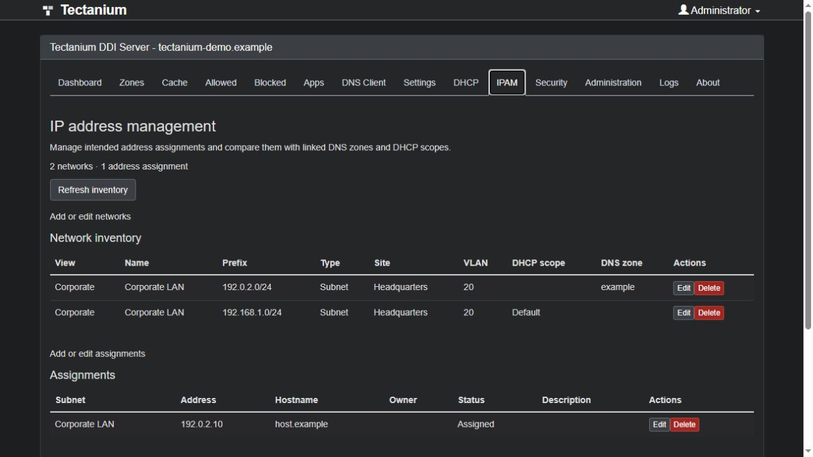
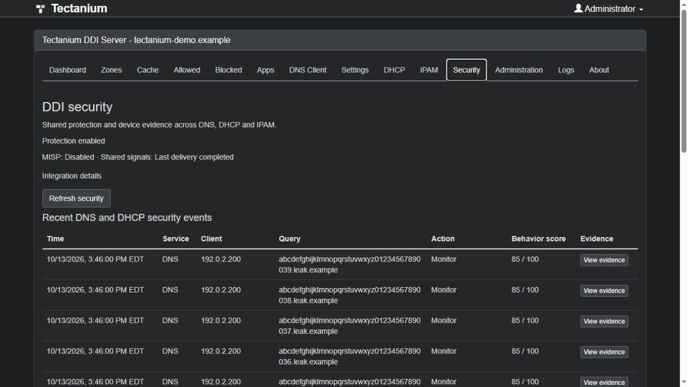
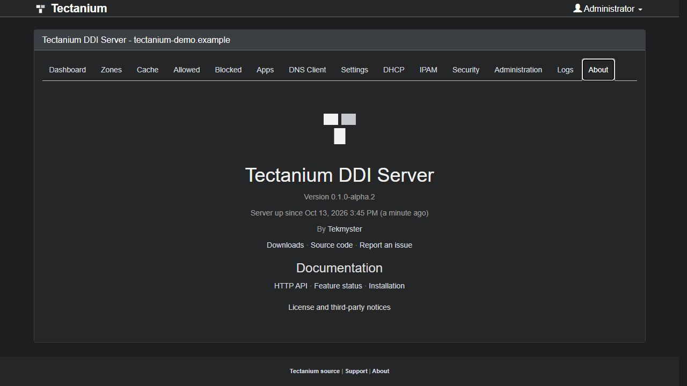
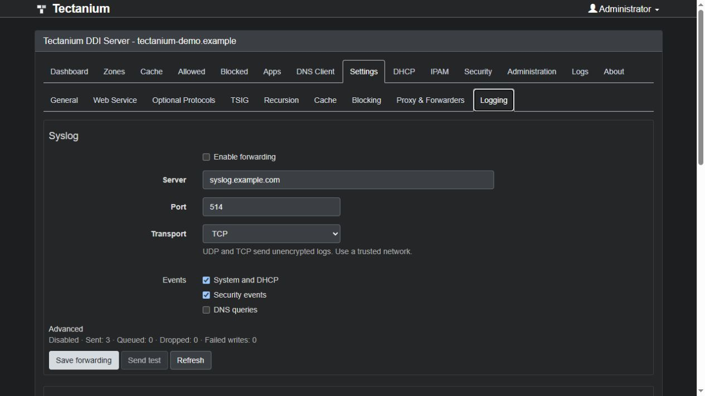
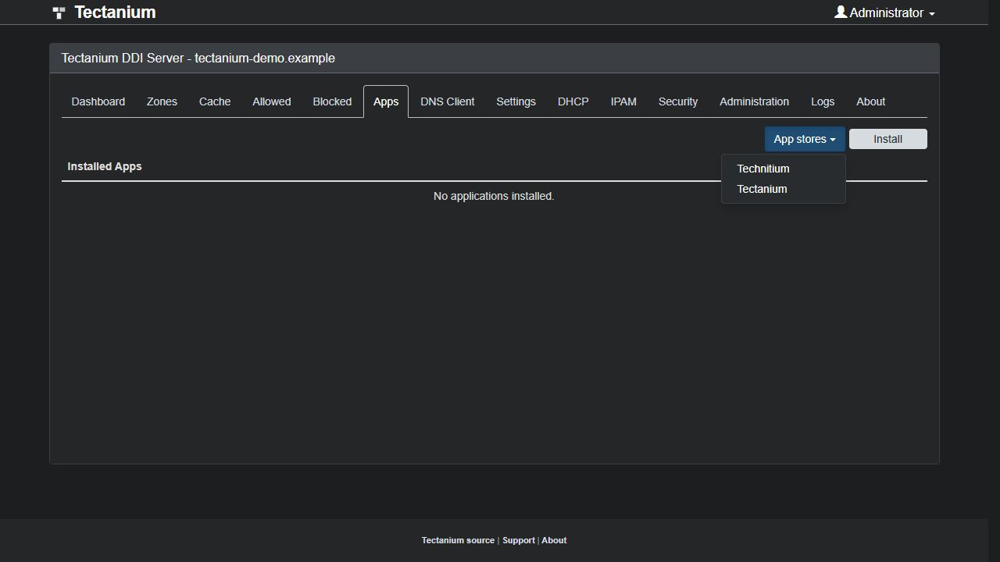

# teQnatium DDI Server

Open-source DNS, DHCP and IP address management from [Arqilo](https://arqilo.com), with shared security evidence and optional local model assistance.

**Current version: 0.1.0-alpha.4.** Evaluate the alpha in an isolated deployment. See [feature status](docs/FEATURE-MATRIX.md) for implemented capabilities and remaining work.

[Download packages](https://github.com/tekmyster/teQnatium-DDI-Server/releases) · [Installation](packaging/INSTALL.md) · [Report an issue](https://github.com/tekmyster/teQnatium-DDI-Server/issues) · [Arqilo](https://arqilo.com)

## Downloads

| Platform | Package |
| --- | --- |
| Windows x64 | Setup ZIP or self-contained portable ZIP |
| Linux x64 / ARM64 | Self-contained tar.gz and systemd installer |
| Windows / Linux / macOS / Raspberry Pi | Portable ZIP or tar.gz; requires the .NET 10 ASP.NET Core Runtime |
| Docker | Loadable Linux x64 image archive and Compose example |

Release downloads include SHA256SUMS. The installers use separate teQnatium services and configuration directories, generate an initial admin credential, and leave host DNS and firewall settings unchanged. Windows setup is unsigned. Existing deployments require the [backup and migration workflow](docs/BACKUP-MIGRATION.md); the alpha installers do not replace them automatically.

## Console

The screenshots below show an isolated demonstration with example data.

## Capabilities

- Authoritative and recursive DNS, DNSSEC and encrypted DNS transports.
- Distributed IPv4 DHCP allocation and synchronization across multiple owners, with durable offers/leases and fenced recovery in the Hyper-V lab.
- IPv4/IPv6 IPAM inventory, network views, assignments, utilization and DNS/DHCP reconciliation.
- Reviewed publication of managed prefixes and addresses to NetBox.
- Local threat indicators, asynchronous MISP enrichment, shared DNS/DHCP evidence and analyst investigations.
- Explainable tunneling and DGA-pattern suspicion, periodic DNS observations and visible sampling limits.
- Optional Chat Completions-compatible event explanations, including separately operated local GPU model servers. Explanations are advisory and cannot change protection.
- Native configuration backups, migration previews and policy rollback.
- Native [UDP/TCP syslog forwarding](docs/SYSLOG.md) for system/DHCP logs, security events and optional DNS queries.

Predictive intelligence, trained classifiers, learned baselines, DHCPv6 and several HA/IPAM workflows remain in development. Read [the feature matrix](docs/FEATURE-MATRIX.md) and [security roadmap](docs/SECURITY-ROADMAP.md) before planning a deployment.

## App stores

In Apps, open **App stores** and select **Technitium** to use its existing in-console catalog, or **teQnatium** to visit [tectanium.tekmyster.com](https://tectanium.tekmyster.com). ZIP installation remains available.

 The teQnatium portal entry does not imply that a hosted catalog has been deployed or verified.

## Documentation

- [Build from source](build.md)
- [HTTP API](APIDOCS.md)
- [Environment variables](DockerEnvironmentVariables.md)
- [IPAM](docs/IPAM.md)
- [DHCP synchronization](docs/DHCP-SYNCHRONIZATION.md)
- [Backup and migration](docs/BACKUP-MIGRATION.md)
- [Optional model assistance](docs/SECURITY-LLM.md)
- [Product UX contract](docs/PRODUCT-UX.md)
- [Original logo and variants](docs/branding/README.md)

## License

teQnatium is distributed under [GNU GPL v3](LICENSE). Original copyright and required attribution are preserved in source headers and [third-party notices](THIRD-PARTY-NOTICES.md). Product versioning is independent of the retained engine compatibility identity used by existing APIs, applications and cluster checks.
